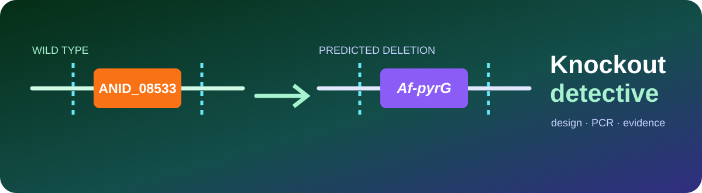
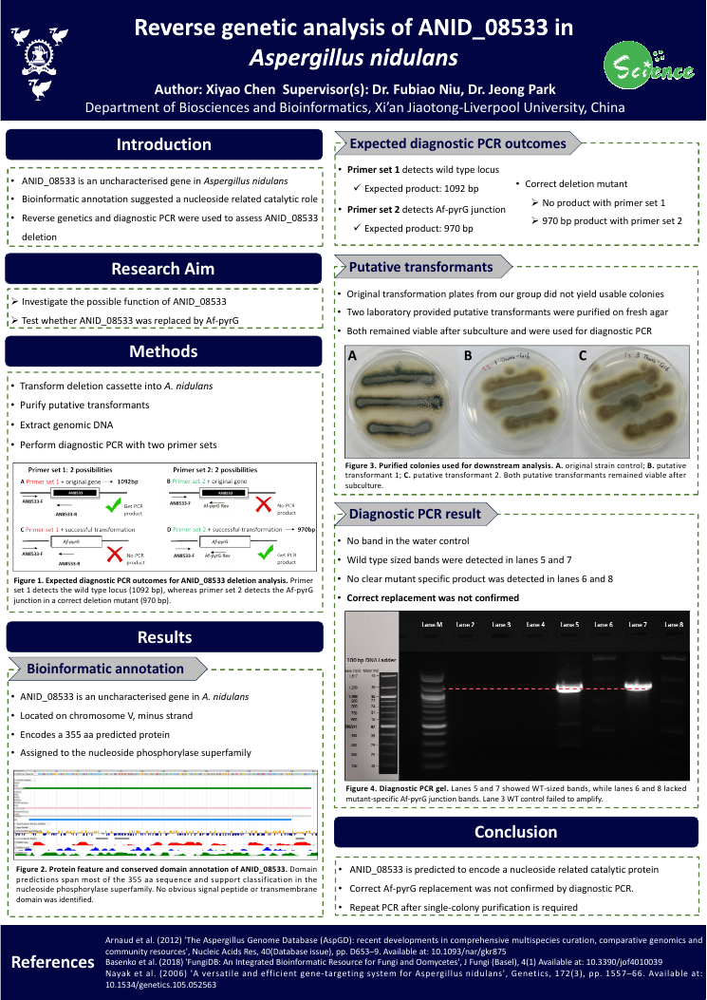
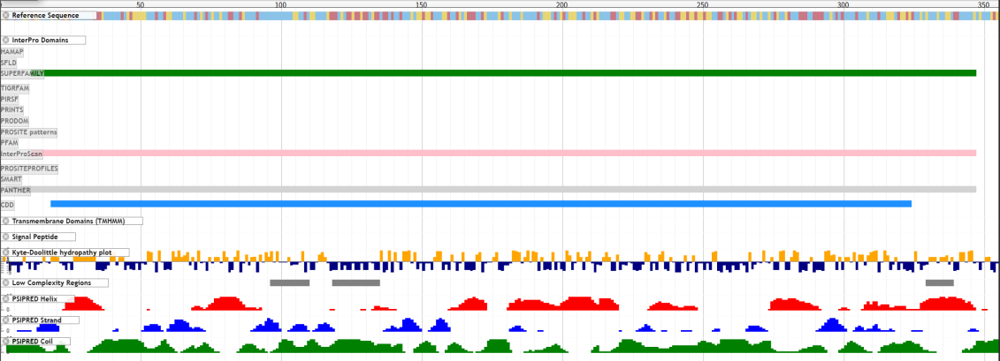
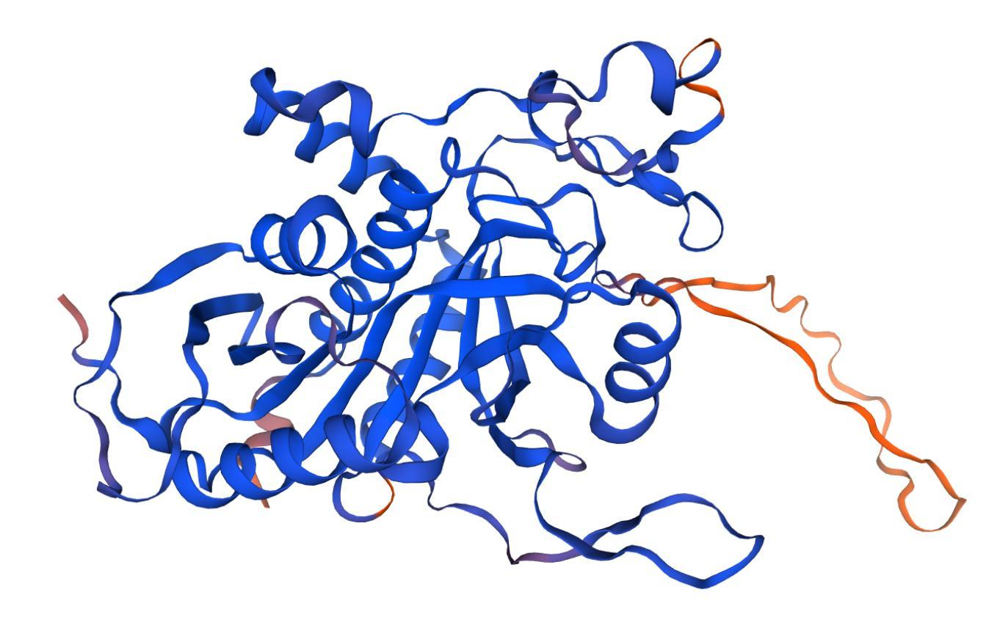
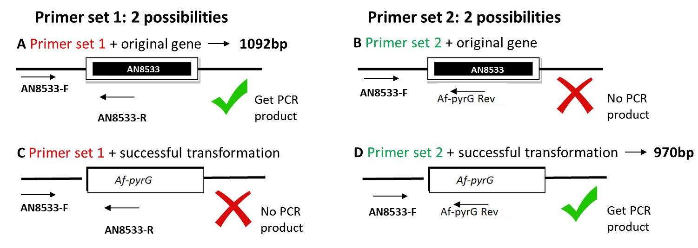
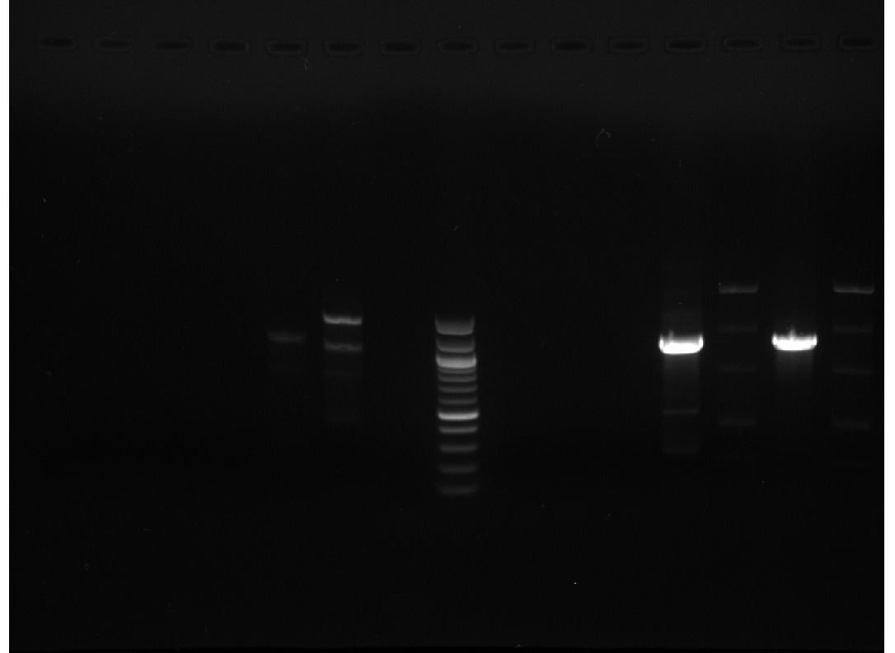
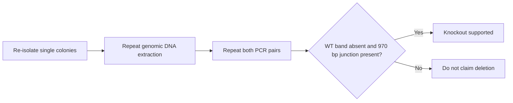

<div align="center">



[](https://github.com/Ci-yo/BIO204-Lab3-Reverse-Genetics/actions/workflows/repository-check.yml)


**A reverse-genetics investigation where the most important result is knowing when a knockout has not been proven.**

</div>

## Step-by-step guide

### 1. Prepare your computer and get the files

Use [Python 3.10 or later](https://www.python.org/downloads/).
Check `python --version` in your terminal. On Windows, select the installer's
option to add Python to PATH, or use `py` in place of `python`. Install [Git](https://git-scm.com/downloads) to use the commands below.
Run them in a **terminal** (PowerShell on Windows; Terminal on macOS/Linux):

```bash
git clone https://github.com/Ci-yo/BIO204-Lab3-Reverse-Genetics.git
cd BIO204-Lab3-Reverse-Genetics
```

Alternatively, use **Code → Download ZIP**, extract it, and open a terminal in
the extracted folder. All commands below start in the folder containing
`README.md`. A second run replaces the generated outputs named below.

### 2. Locate the sequence and structure inputs

The repository includes two annotated GenBank files in [`sequences/`](sequences/),
one predicted protein PDB in [`structures/`](structures/), and the recorded
diagnostic observations in [`data/`](data/). The summary uses Python's standard
library; no `pip install` step is needed.

### 3. Build the computational inventory

```bash
python scripts/summarize_design.py
python scripts/validate_repository.py
```

The first command reports **two loci** and the number of modelled residues.
The validator checks the archived files and recorded interpretation.

### 4. Inspect the output

| Output | Contents |
|---|---|
| [`results/sequence_inventory.csv`](results/sequence_inventory.csv) | GenBank locus names, sequence lengths and annotated feature labels. |
| [`results/structure_inventory.csv`](results/structure_inventory.csv) | Atom-record and modelled-residue counts for the predicted structure. |
| [`data/diagnostic_pcr_lanes.csv`](data/diagnostic_pcr_lanes.csv) | Recorded lane calls to compare with the archived gel image. |

To view the protein, install PyMOL, start it with the repository root as its
working directory, then enter this in the **PyMOL command line**:

```pml
@scripts/view_model.pml
```

The script resets the current PyMOL scene and displays the supplied model as
a cartoon. It does not predict a new structure or establish that a deletion
was experimentally confirmed.

### 5. Troubleshooting

| Symptom | Action |
|---|---|
| `python` is not recognised | Check the Python installation; on Windows try `py --version`. |
| An input file cannot be found | Run from the repository root and extract the complete ZIP, not just the script. |
| PyMOL cannot load the PDB | Set its working directory to this repository, then rerun the `.pml` command. |
| The poster and inventory seem to answer different questions | The inventory audits files; the poster interprets the experimental observations. Read both before drawing conclusions. |

## Poster showcase

[](showcase/BIO204-Lab3-Poster.pdf)

The one-page poster turns the full investigation into a visual evidence trail: target annotation, deletion design, transformant screening, diagnostic PCR and the deliberately cautious conclusion. **[Open the full-size poster (PDF)](showcase/BIO204-Lab3-Poster.pdf).**

## The target

`ANID_08533` is an uncharacterised *Aspergillus nidulans* gene on chromosome V. Sequence and domain evidence point toward a nucleoside-related catalytic protein, but that remains a prediction rather than an experimentally confirmed function.

| Gene | Protein | Predicted family | Model quality |
|---|---:|---|---|
| ANID_08533 / AN8533 | 355 aa | Nucleoside phosphorylase superfamily | 74.13% identity · 0.97 coverage · GMQE 0.84 |

|  |  |
|---|---|
| Conserved-domain evidence spans most of the sequence. | The SWISS-MODEL prediction suggests a compact globular fold. |

## The knockout logic

The deletion design replaces the target region with **Af-pyrG**. Two diagnostic primer pairs turn that design into a falsifiable test.



| Genotype | Primer set 1: target locus | Primer set 2: Af-pyrG junction |
|---|---:|---:|
| Wild type | 1092 bp | no product |
| Correct deletion | no product | 970 bp |

## The evidence did not close the case

The two putative transformants produced wild-type-sized bands with primer set 1, while no mutant-specific product appeared with primer set 2. The original wild-type control also failed to amplify, so the result is best described as **not confirmed**, rather than a definitive failed transformation.

| Observation | Interpretation |
|---|---|
| Lanes 5 and 7: approximately 1.1–1.2 kb | Wild-type locus remained detectable |
| Lanes 6 and 8: no clear 970 bp product | No support for the Af-pyrG junction |
| Wild-type control failed | Overall interpretation remains provisional |

<details>
<summary><strong>🧫 Open a source diagnostic gel from the G13–16 class set</strong></summary>



The published lane table in `data/diagnostic_pcr_lanes.csv` records the interpretation used for this project.

</details>

## What would settle it?



## Repository map

```text
├── data/        gene facts, primers and diagnostic lane calls
├── sequences/   annotated wild-type and predicted deletion loci
├── structures/  predicted ANID_08533 protein model
├── figures/     design, gel and protein evidence
├── showcase/    full research poster and GitHub preview
├── results/     machine-readable design inventory
└── scripts/     sequence summary, validation and PyMOL view
```

---

<div align="center">

**BIO204 Lab 3 · reverse genetics with an evidence-first conclusion**

</div>
